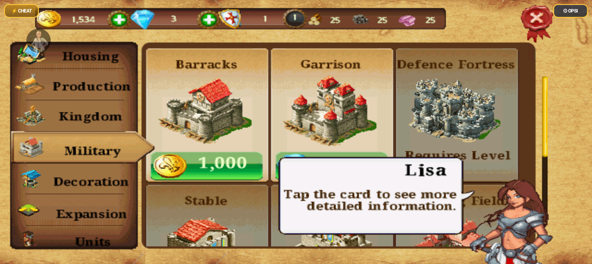

# 👑 Kingdoms & Lords — Android Port + Built-in Cheat Engine

[](https://github.com/GUPRON98/KingdomsAndLords-Android)
[](https://github.com/GUPRON98/KingdomsAndLords-Android)

Port Android dari **Kingdoms & Lords** (Nokia 5800 `640x360` J2ME) dengan tampilan **Fullscreen Landscape**, **Full Touchscreen Controls**, **Built-in Cheat Engine (`⚡ CHEAT`)**, dan **Menu Opsi (`⚙ OPSI`)**.

---

## 📸 Screenshot

| Gameplay Fullscreen |
| :---: |
|  |

---

## ⚡ Fitur Utama

- 📱 **Fullscreen Landscape (`640x360`)**: Mendukung mode layar penuh (*stretch*) maupun aspek rasio asli melalui tombol `⚙ OPSI`, plus pengaturan target FPS dan getar tombol.
- 👆 **Full Touchscreen Support**: Kontrol sentuh native dari versi Nokia 5800 dipetakan penuh ke layar landscape.
- ⚡ **Built-in Cheat Engine (`⚡ CHEAT`)**:
  - 💰 **Tambah Emas (+50.000 Gold)**
  - 💎 **Tambah Berlian (+5.000 Diamonds)**
  - ⚡ **Isi Penuh Energi (+100 Energy)**
  - 🪵 **Tambah Kayu, Makanan & Mana (+50.000)**
  - ⭐ **Tambah XP (+5.000 XP)**
  - ⚡ **Aktifkan Semua Cheat Sekaligus**

---

## 📦 Download APK

Unduh file APK siap pasang:
- **[KingdomsAndLords.apk](KingdomsAndLords.apk)** (`minSdkVersion 21`, `targetSdkVersion 34`, pure Java/Smali tanpa native `.so`)

---

## 🛠️ Build dari Source (Termux / Linux)

```bash
chmod +x build_apk.sh
./build_apk.sh
```
